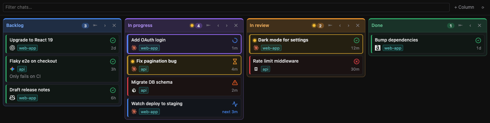
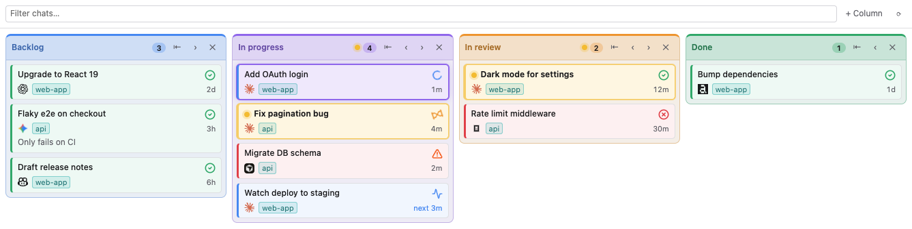

# Orca용 Chat Board

[English](README.md) | **한국어**

**에이전트 대화**를 칸반 보드로 보여 주는 Orca 플러그인입니다. 모든 Orca 워크스페이스에 열려 있는 Claude, Codex, Cursor, Gemini 등의 에이전트 탭(터미널이든 채팅이든)이 카드 한 장씩이 됩니다. Orca의 워크스페이스 보드는 일을 워크스페이스별로 묶고, Chat Board는 대화별로 묶습니다. 한 워크스페이스 안에 주제가 다른 대화를 여러 개 열어 두고 쓸 때 도움이 됩니다.



> **이것은 포크입니다.** 원본은 [SantiagoCaprile/orca-chat-board](https://github.com/SantiagoCaprile/orca-chat-board)이고, 이 포크는 `workspace-sync` 브랜치입니다. 원본 1.1.1에 다음을 더했습니다.
>
> - Windows에서 보드가 동작합니다(원본 이슈 #1).
> - Orca의 워크스페이스 보드와 양방향으로 맞춰집니다.
> - 카드마다 답장 창이 있어, 보드를 떠나지 않고 대화의 마지막 내용을 읽고 이미지까지 붙여 답할 수 있습니다.
> - 체크한 대화는 끝나면 답장 창이 저절로 열리고, 답을 기다리는 동안 핑크로 표시할 수 있습니다.
> - 카드의 버튼으로 Orca의 탭을 닫아 대화를 보관할 수 있습니다.
> - Orca를 다시 켠 뒤 보관된 Claude 대화를 다시 열 수 있습니다.
> - 한국어 화면이 있습니다.
>
> 이 가운데 원본 릴리스에 들어간 것은 없습니다. 스크린샷은 원본의 것이라 이 기능들이 보이지 않습니다.

이 문서는 화면의 버튼과 설정 이름을 한국어 화면 기준으로 적었습니다.

## 목차

- [설치](#설치)
- [보드 쓰기](#보드-쓰기)
- [대화에 답하기](#대화에-답하기)
- [체크한 대화](#체크한-대화)
- [보관함과 대화 이어 가기](#보관함과-대화-이어-가기)
- [워크스페이스 보드와 동기화](#워크스페이스-보드와-동기화)
- [설정](#설정)
- [뭔가 이상해 보일 때](#뭔가-이상해-보일-때)
- [권한](#권한)
- [한계](#한계)
- [동작 원리](#동작-원리)와 [개발](#개발)

## 설치

### 원본 릴리스

```sh
orca plugin install SantiagoCaprile/orca-chat-board
```

Orca가 플러그인이 요청하는 접근 권한([권한](#권한) 참고)을 보여 주고 승인을 받습니다. 그다음 오른쪽 사이드바의 액티비티 바에서 **Chat Board**를 엽니다. Windows에서는 이 릴리스의 보드가 비어 있으니 포크를 쓰세요.

### 이 포크

포크는 내 컴퓨터의 폴더에서 Orca *개발 플러그인*으로 돌아갑니다. Orca가 TypeScript 파일을 그대로 읽으므로 빌드할 것이 없고, 폴더의 파일이 바뀌면 플러그인을 자동으로 다시 불러옵니다.

1. 코드를 받고 브랜치를 바꿉니다.

   ```sh
   git clone https://github.com/walden4u/orca-chat-board
   cd orca-chat-board
   git checkout workspace-sync
   ```

2. 폴더를 Orca에 불러옵니다.

   ```sh
   orca plugin dev load .
   ```

   코드를 실행하는 플러그인이라 처음에는 `approval_required`로 멈춥니다. 요청하는 접근 권한을 보여 주고, 같은 명령에 `--approve <fingerprint>`를 붙인 것을 출력합니다. 그 명령을 실행하면 승인됩니다.

3. 카탈로그에서 원본 플러그인도 설치했다면, Chat Board 패널이 두 개 뜨지 않도록 원본을 끕니다.

   ```sh
   orca plugin disable santiagocaprile.chat-board
   ```

4. 실행 중인지 확인합니다. 포크는 `dev` 표시가 붙은 `local.chat-board`로 나옵니다.

   ```sh
   orca plugin list
   # local.chat-board 1.1.1  running  trusted-worker, dev
   ```

5. 오른쪽 사이드바의 액티비티 바에서 **Chat Board**를 열거나 `orca plugin open local.chat-board`를 실행합니다.

이제 이 폴더는 **Settings → Plugins → Development folders**에 남고, Orca가 켜질 때마다 다시 불러옵니다. 빼려면 `orca plugin dev unload local.chat-board`를 실행합니다.

카탈로그로 설치한 플러그인의 파일은 고치지 마세요. Orca가 파일 해시를 확인하므로 바뀌면 플러그인을 꺼 버립니다. 수정은 개발 폴더에서 합니다.

## 보드 쓰기

에이전트가 돌아가는 탭 하나가 카드 한 장입니다. 터미널 탭은 바로, Orca의 채팅 탭은 대화가 생긴 뒤에 카드가 됩니다. 기본 설정에서는 보드에 자체 컬럼 네 개(Backlog, In progress, In review, Done)가 있고, 새 대화는 첫 컬럼에 들어옵니다.

| 하고 싶은 일 | 방법 |
|---|---|
| 대화의 마지막 답을 읽고 답하기 | 카드를 클릭합니다. [대화에 답하기](#대화에-답하기) 참고. |
| Orca의 그 대화로 가기 | 카드를 더블클릭하거나, 카드나 답장 창의 ↗를 누릅니다. |
| 어떤 대화였는지 보기 | 카드에 마우스를 잠깐 올립니다. |
| 대화가 끝나면 알아서 뜨게 하기 | 카드 왼쪽 위의 상자를 클릭합니다. [체크한 대화](#체크한-대화) 참고. |
| 대화 옮기기 | 카드를 다른 컬럼으로, 또는 같은 컬럼 안에서 위아래로 끕니다. |
| 대화 이름 바꾸기, 메모 달기 | 카드의 ✎를 누릅니다. Enter로 저장하고, 메모에서는 Shift+Enter로 줄을 바꿉니다. 이름은 Orca 탭의 이름입니다. |
| 대화 찾기 | 필터 칸에 입력합니다. 제목, 메모, 워크스페이스, 에이전트에서 찾습니다. |
| 보드를 지금 갱신하기 | ⟳를 누릅니다. |
| 답을 기다리는 대화를 한눈에 보기 | 대화를 체크하고 핑크 설정을 켭니다. [핑크: 답을 기다리는 대화](#핑크-답을-기다리는-대화) 참고. |
| 대화 치우기 | 카드에 마우스를 올리고 ▾를 누른 뒤, 빨간 확인 문구를 한 번 더 누릅니다. [보관함](#보관함과-대화-이어-가기) 참고. |
| 닫았던 대화 이어 가기 | 툴바의 **보관 N**을 누릅니다. [보관함](#보관함과-대화-이어-가기) 참고. |

### 카드에 보이는 것

- **상태 아이콘:** 에이전트가 일하는 동안은 도는 원, 내 답을 기다리면 모래시계, 끝나면 체크, 중단되면 빨간 X, 권한이 필요하면 경고 표시입니다.
- **점이 붙은 노란 카드:** 다른 대화를 보는 사이에 에이전트가 멈췄다는 뜻입니다. Orca의 안 읽은 탭 표시와 같습니다. 그 컬럼의 머리에도 점이 붙습니다. 답장 창에서 그 대화를 읽거나, 대화를 열거나, 에이전트가 다시 일하기 시작하면 사라집니다.
- **색 테두리:** 지금 Orca에서 열어 둔 대화입니다.
- **맥박 아이콘과 "다음 3분":** 그 대화에서 루프나 감시가 돌고 있습니다. `/loop`(`ScheduleWakeup`), `CronCreate` 예약, `Monitor` 감시가 해당됩니다. 루프가 한 주기쯤 실행을 놓치면 카드에 "신호 없음"이 표시됩니다.
- **왼쪽 위의 상자:** 체크입니다. 열려 있는 모든 카드의 같은 자리에 있습니다. 체크하지 않은 대화는 빈 상자, 체크한 대화는 ✓가 든 상자입니다. 클릭하면 켜지고 꺼집니다. 보관된 카드에는 상자가 없습니다.
- **핑크 카드:** 핑크 설정이 켜져 있을 때, 체크한 대화의 에이전트가 멈춰서 나를 기다리고 있다는 뜻입니다. [핑크: 답을 기다리는 대화](#핑크-답을-기다리는-대화) 참고.
- **로고, 워크스페이스, 시간, 메모:** 에이전트 로고(Orca가 쓰는 것과 같은 아이콘으로, Orca가 아는 45개 에이전트 모두), 워크스페이스 이름, 마지막 변화 뒤 지난 시간, 내가 적은 메모입니다.

카드에 마우스를 올리면 오른쪽 위에 버튼도 나옵니다: ↗(Orca의 대화로 가기), ✎(이름·메모), ▾(보관). 보관된 카드에는 ✎와 ✕(보드에서 제거)가 나옵니다.

카드에 마우스를 올리면 내 마지막 메시지와 에이전트의 마지막 답이 미리 보기로 뜹니다. 폭은 패널만큼, 높이는 카드 위나 아래에 남은 공간만큼입니다.

### 컬럼

**+ 컬럼**으로 컬럼을 추가하고, 제목을 더블클릭해 이름을 바꾸고, ‹ ›로 순서를 바꾸고, ⇤로 좁은 띠로 접고, 삭제할 수 있습니다. 삭제한 컬럼의 카드는 첫 컬럼으로 갑니다. **Backlog**에 있는 대화에 말을 걸면 카드가 **In progress**로 옮겨집니다. 설정에서 끌 수 있습니다.

[워크스페이스 보드와 동기화](#워크스페이스-보드와-동기화)를 켜면 컬럼이 Orca의 워크스페이스 상태가 되고, 위의 일은 대부분 Orca에서 하게 됩니다.

화면은 Orca의 테마(밝음·어두움)와 언어(`es-*`는 스페인어, `ko-*`는 한국어, 그 밖에는 영어)를 따릅니다.



## 대화에 답하기

카드를 클릭하면 답장 창이 열립니다. 내 마지막 메시지와 에이전트의 마지막 답 전체가 Orca 기록의 시각과 함께 보이고, 답을 적는 칸이 있습니다.

| 하고 싶은 일 | 방법 |
|---|---|
| 답 보내기 | 적고 Enter를 누릅니다. Shift+Enter는 줄바꿈입니다. |
| 에이전트가 추천한 문구 쓰기 | 빈 입력 칸에서 Tab을 누릅니다. |
| 이미지 붙이기 | 입력 칸에 붙여 넣거나, 이미지 파일을 창 위에 끌어다 놓습니다. |
| 대화 자체로 가기 | 창의 ↗를 누릅니다. |
| 창 닫기 | ✕, Escape, 또는 창 바깥 클릭. 적던 글은 패널을 다시 불러오기 전까지 그 대화용으로 남습니다. |

- **보내기**는 내 글을 그 대화의 터미널에 다음 프롬프트로 입력합니다. 창이 닫히고 툴바 아래에 확인 문구가 한 줄 뜹니다.
- **Tab으로 에이전트의 추천을 가져옵니다.** 에이전트가 자기 입력 칸에 다음 프롬프트를 준비해 두었으면(Claude Code는 답한 뒤 흐린 글씨로 보여 줍니다), 답장 창의 빈 입력 칸에 그 문구가 흐리게 보이고 Tab을 누르면 채워집니다. 그대로 보내거나 고쳐서 보낼 수 있습니다. 창이 열릴 때 그 대화의 터미널에서 읽어 옵니다. 그 터미널에 적어 두고 보내지 않은 글도 같은 방식으로 나타납니다.
- **이미지:** 메시지 하나에 5장까지, 한 장에 10MB까지, PNG·JPEG·GIF·WebP를 붙일 수 있습니다. 작은 그림으로 표시되고 뺄 수 있으며, 보내기를 누르면 글보다 먼저 붙습니다. 이미지만 보낼 수도 있습니다. 워커가 각 이미지를 임시 폴더의 `orca-chat-board`에 파일로 쓰고 그 경로를 대화의 터미널에 붙여 넣으면, Claude Code가 이미지 파일의 경로를 첨부 이미지(`[Image #1]`)로 바꿉니다. 다른 에이전트는 경로만 볼 수도 있습니다. 사흘이 지난 파일은 다음에 이미지를 보낼 때 지워집니다.
- **창 옆에 대화 보기.** 설정 **"답장 창과 함께 Orca 대화창 보기"**를 켜면 답장 창이 열릴 때 Orca도 그 대화의 탭으로 바뀌어, 전체 대화가 창 옆에 보입니다. 저절로 뜬 창은 그 창을 클릭한 뒤에만 바뀝니다. 먼저 바꾸면 입력 중이던 탭을 빼앗기 때문입니다.
- **Orca의 채팅 탭**은 창에서 읽을 수는 있지만 답할 수는 없습니다. Orca에 채팅 탭으로 글을 보내는 명령이 없습니다. 권한을 요청한 대화도 읽기 전용으로 열립니다. 대화 자체(↗)에서 답하세요.
- **Orca의 기록이 오래됐을 때.** 어떤 세션은 Orca에 상태를 알리지 않게 됩니다. Orca를 다시 켰을 때 열려 있던 세션이 그렇습니다. Orca의 기록이 그 대화의 터미널보다 2분 넘게 뒤처져 있으면, 창은 예전 내용 아래에 터미널의 현재 화면을 함께 보여 줍니다. 창에서 보낸 뒤에는 Orca의 기록이 따라올 때까지 내가 보낸 글이 거기에 표시됩니다.

## 체크한 대화

카드를 체크하면(왼쪽 위에 항상 있는 상자. 다시 누르면 해제), 그 대화의 에이전트가 끝나거나 뭔가 물어볼 때 답장 창이 저절로 열립니다. 그 대화의 탭이 Orca 화면에 떠 있을 때도 열립니다.

- **하나씩 차례로.** 창에 답하거나, **다음** 또는 ✕로 답하지 않고 넘기면, 다음으로 끝난 체크 대화의 창이 끝난 순서대로 열립니다. 창에 몇 개가 기다리는지 나옵니다.
- **키보드를 가져가지 않습니다.** 저절로 뜬 창은 커서를 원래 자리에 둡니다. 다른 곳에 치던 글이 그대로 거기에 들어갑니다. 창에 입력하려면 입력 칸을 클릭하세요.
- **차례를 기다립니다.** 다른 창, 편집, 끌기가 진행 중이거나 패널이 보이지 않는 동안에는 열리지 않고, 돌아오면 열립니다.
- **대화 자체로 떠나면(↗) 나머지는 2분 동안 미뤄집니다.** 그 사이에 다른 체크 대화가 끝나면 다시 열립니다.
- **루프는 실행할 때마다 창을 열지 않습니다.**

체크는 카드와 함께 저장됩니다. 체크하지 않은 대화는 노랗게만 됩니다.

### 핑크: 답을 기다리는 대화

저절로 뜬 답장 창은 닫고 나면 놓치기 쉽고, 끝난 대화는 다른 카드와 똑같아 보입니다. 설정 **"답을 기다리는 체크 대화를 핑크로 표시"**(기본 꺼짐)는 내가 말할 차례인 대화를 표시합니다.

**카드가 핑크가 되는 때.** 세 가지가 모두 맞아야 합니다.

1. 설정이 켜져 있다.
2. 카드가 체크돼 있다.
3. 에이전트가 일하고 있지 않다: 끝났거나(체크 아이콘), 뭔가 물어봤거나(모래시계), 권한이 필요하다(경고 표시).

그 대화를 이미 봤는지는 따지지 않습니다. 한 시간 전에 읽고 답하지 않은 대화도 여전히 핑크입니다.

**핑크가 꺼지는 때.**

- 답을 보내 에이전트가 다시 일하기 시작할 때. 그 턴이 끝나면 다시 핑크가 됩니다.
- 카드의 체크를 풀 때. 답할 생각이 없는 대화는 이렇게 하세요.
- 대화를 보관하거나 설정을 끌 때.

**핑크가 되는 것.**

- 카드: 바탕과 테두리.
- 툴바: 핑크 카드가 하나라도 있는 동안 옅은 핑크 바탕과 아래쪽 핑크 줄. 그 카드가 스크롤 밖에 있거나 컬럼이 접혀 있어도 기다리는 것이 있음을 알 수 있습니다.

**핑크와 노랑.** 노랑은 "아직 안 본" 표시로, 체크 여부와 상관없이 모든 대화에 쓰이고 보는 즉시 사라집니다. 핑크는 답에 관한 표시로, 체크한 대화에만 쓰이고 답할 때까지 남습니다. 체크한 대화가 둘 다에 해당하면 핑크로 그려집니다.

**답장 창의 대기 순서와는 별개입니다.** 다음에 어떤 답장 창이 열릴지는 여전히 아직 안 본 대화를 기준으로 합니다(위 참고). 핑크는 보드에 색만 칠하고 아무것도 열지 않습니다.

상태 아이콘이 없는 대화(Orca가 아직 상태를 알려 주지 않은 대화. [한계](#한계) 참고)는 핑크가 되지 않습니다.

## 보관함과 대화 이어 가기

닫은 대화는 보관함으로 가고 컬럼, 메모, 체크를 그대로 가집니다. 카드는 Orca에 탭이 열려 있는 동안에만 보드에 있으므로, 보관하는 방법은 두 가지이고 둘 다 탭을 닫습니다.

- **Orca에서:** 그 대화의 탭을 닫습니다. 다음 확인 때(15초 안, ⟳를 누르면 바로) 카드가 보관함으로 갑니다.
- **카드에서:** 카드에 마우스를 올리고 오른쪽 위 버튼 중 **▾**를 누릅니다. 버튼이 빨갛게 바뀌며 묻습니다. 3초 안에 한 번 더 누르면 진행되고, 그냥 두면 아무 일도 일어나지 않습니다. Orca가 그 대화의 탭 전체를 닫고 카드는 바로 보관함으로 갑니다. 그 대화의 답장 창이 열려 있었으면 함께 닫힙니다.

빨간 확인 문구는 대화에 따라 다릅니다.

| 대화 | 문구 | 잃는 것 |
|---|---|---|
| 터미널 탭의 Claude 대화, 작업 중 아님 | "탭을 닫을까요?" | 없음. 보관함에서 이어 갈 수 있습니다. |
| 에이전트가 작업 중인 대화 | "작업을 멈추고 닫을까요?" | 진행 중이던 턴. |
| 다른 에이전트의 대화 | "닫을까요? 다시 열 수 없습니다" | 보드에서 되돌아갈 길. ↻ 이어 열기는 Claude 대화에만 있습니다. |

Orca의 채팅 탭(터미널이 아닌 탭)은 밖에서 닫을 수 없습니다. 버튼이 그렇게 알리고 대화는 그대로 둡니다.

보관함 자체는 기본으로 접혀 있습니다. 툴바의 **보관 N**이 보관된 대화 수를 보여 주고, 누르면 보드 아래에 패널 높이의 40%까지 펼쳐집니다. 같은 버튼이나 보관함의 제목 줄을 누르면 다시 접힙니다. 카드 하나는 ✕로, 전부는 **비우기**로 지웁니다.

Orca는 다시 켜질 때 에이전트 탭을 유지하지 않으므로, 다시 켠 뒤에는 카드 대부분이 보관함에 있습니다. 그런 대화를 이어 가려면 카드의 **↻ 이어 열기**를 누릅니다.

1. Orca의 새 에이전트 탭과 같은 방식으로 그 카드의 워크스페이스에 Claude가 시작됩니다. 그래서 Orca가 상태를 추적하고, 그 탭을 화면에 보여 줍니다.
2. 몇 초 뒤 Claude의 그 폴더 대화 목록이 뜹니다(플러그인이 `/resume`을 입력합니다). 이어 갈 대화를 고르세요. 대신 골라 주지 않습니다.
3. 카드가 보관함에서 나와 메모와 체크를 가진 채 새 탭의 카드로 원래 컬럼에 돌아옵니다.

터미널 탭의 Claude 대화에서만 됩니다. 다른 에이전트와 Orca의 채팅 탭에는 아직 이 버튼이 없습니다.

## 워크스페이스 보드와 동기화

패널 툴바의 **⇄**를 누르거나 설정에서 **"워크스페이스 보드와 동기화"**를 켭니다. 그때부터 두 보드는 같은 것을 두 방향에서 보여 줍니다. Orca의 보드는 워크스페이스별로, 이 보드는 대화별로.

- **컬럼이 워크스페이스 상태가 됩니다.** Orca의 상태(Todo, In progress, In review, Done과 직접 만든 상태)가 컬럼이 됩니다. 동기화를 켜면 기존 컬럼은 대체되고, 각 대화는 자기 워크스페이스의 상태에 해당하는 컬럼으로 갑니다.
- **여기서 대화를 끌면 Orca가 따라옵니다.** 카드를 다른 컬럼에 놓으면 Orca에서 그 워크스페이스의 상태가 바뀝니다. 워크스페이스에는 상태가 하나뿐이라 같은 워크스페이스의 다른 대화도 함께 움직입니다.
- **Orca에서 워크스페이스를 옮기면 여기의 대화가 따라옵니다.** Orca가 변경을 알려 주지 않으므로 패널에는 10초쯤 안에 나타납니다. ⟳를 누르면 바로 보입니다.
- **Orca 쪽이 기준입니다.** 갱신할 때마다 카드를 자기 워크스페이스 상태의 컬럼으로 되돌립니다.
- **컬럼 이름은 Orca의 상태 이름입니다.** Orca에서 상태 이름을 바꾸면 다음 갱신 때 컬럼도 바뀝니다. Orca에서 워크스페이스 보드를 열고 **Board settings** 메뉴의 **Statuses** 목록에서 상태를 이름 바꾸기, 추가, 삭제합니다. 이름을 Orca에서 가져오는 동안에는 여기서 컬럼 이름을 바꿀 수 없습니다.
- **컬럼은 여기서 순서 바꾸기(‹ ›)와 접기(⇤)만 되고, 추가와 삭제는 안 됩니다.** Orca에서 추가한 상태는 바로 컬럼이 생기고, 삭제한 상태는 그 상태를 쓰는 워크스페이스가 없어지면 컬럼이 사라집니다.
- **동기화 중에는 "대화를 시작하면 In progress로 이동"이 동작하지 않습니다.** 상태가 워크스페이스의 것이 되기 때문입니다.

⇄를 다시 누르면 멈춥니다. 컬럼은 그대로 남아 이름 바꾸기, 추가, 삭제가 되는 보통 컬럼이 됩니다.

### 상태 이름을 읽는 방법

Orca의 CLI도 플러그인 API도 상태의 이름을 알려 주지 않습니다. 그래서 동기화가 켜져 있을 때만 워커가 Orca의 프로필 데이터베이스를 읽기 전용으로 열어 상태 목록을 가져옵니다. Orca 데이터 폴더(Windows에서는 `%APPDATA%\orca`) 아래 활성 프로필 폴더의 `profile-state.db`, 문서 `ui`, 필드 `workspaceStatuses`입니다. 각 상태의 id와 이름만 읽고, 그 파일에 쓰는 일은 없습니다.

이것은 Orca의 공식 인터페이스가 아니라서 Orca가 업데이트되면 바뀔 수 있습니다. 어떤 이유로든 읽기에 실패하면 워커가 `status names not read from Orca's profile`을 한 번 기록합니다. 그때 컬럼은 가지고 있던 이름을 유지하고, 새로 만든 상태는 id(`status-5`)로 표시되며, 제목을 더블클릭해 여기서 다시 이름을 바꿀 수 있게 됩니다. Windows의 Orca 1.4.255에서만 써 봤습니다.

## 설정

**Settings → Plugins → Chat Board**에 있습니다.

| 설정 | 기본값 | 하는 일 |
|---|---|---|
| 대화를 시작하면 In progress로 이동 | 켜짐 | Backlog의 대화에 말을 걸면 카드가 In progress로 갑니다. 동기화 중에는 동작하지 않습니다. |
| 워크스페이스 보드와 동기화 | 꺼짐 | 컬럼이 Orca의 워크스페이스 상태가 됩니다. [동기화](#워크스페이스-보드와-동기화) 참고. |
| Orca 자동 확인 | 켜짐 | 패널이 화면에 있는 동안 무엇이 바뀌었는지 Orca에 물어봅니다. 아래 참고. |
| 답장 창과 함께 Orca 대화창 보기 | 꺼짐 | 답장 창이 열리면 Orca도 그 대화의 탭으로 바뀝니다. [대화에 답하기](#대화에-답하기) 참고. |
| 답을 기다리는 체크 대화를 핑크로 표시 | 꺼짐 | 에이전트가 멈춘 체크 대화를 핑크로 그립니다. [핑크](#핑크-답을-기다리는-대화) 참고. |
| 에이전트 로고 표시 | 켜짐 | 카드마다 에이전트의 로고 또는 이름. |
| 워크스페이스 표시 | 켜짐 | 카드마다 워크스페이스 이름. |
| 에이전트 상태 아이콘 표시 | 켜짐 | 작업 중, 답변 대기, 완료, 중단됨, 권한 필요. |
| 마지막 변화 뒤 지난 시간 표시 | 켜짐 | 에이전트 상태가 바뀌거나 대화에 마지막 출력이 나온 뒤 지난 시간. |
| 메모 표시 | 켜짐 | 카드 제목 아래의 메모. |
| 마우스를 올리면 미리 보기 | 켜짐 | 마지막 주고받은 내용을 보여 주는 미리 보기. |
| 언어 (Auto, English, Español, 한국어) | Auto | Auto는 Orca의 언어를 따릅니다. |

이 포크의 설정 화면은 패널 언어와 상관없이 한국어로 나옵니다. Orca가 설정의 제목과 설명을 플러그인의 매니페스트에서 가져오는데, 매니페스트에는 한 언어만 담을 수 있기 때문입니다.

### Orca 자동 확인

Orca는 탭을 바꿔도 플러그인에 알려 주지 않습니다. 그래서 패널이 화면에 있는 동안 Orca에 물어봅니다.

- 에이전트가 일하는 동안, 또는 패널을 쓴 지(마우스를 움직이거나 답을 보낸 지) 30초 안에는 3초마다.
- 아무 움직임이 없으면 15초마다.

확인할 때마다 `orca` CLI를 실행하는데, Windows에서는 1초 넘게 걸리는 일이고 한 번에 하나만 돕니다. 설정을 끄면 멈추고, 손으로 갱신하게 됩니다.

| | 켜짐 | 꺼짐 |
|---|---|---|
| 에이전트 상태 아이콘 | 실시간 | 실시간 |
| 대화가 열리거나 닫힘 | 즉시 | 즉시 |
| 열려 있는 대화의 테두리 | 3초 안(한가할 때 15초) | 여기서 카드를 클릭할 때, 또는 ⟳ |
| 노란 "아직 안 봄" 표시 해제 | 3초 안(한가할 때 15초) | 여기서 카드를 클릭할 때, 또는 ⟳ |
| Orca 워크스페이스 보드의 변경(동기화 중) | 10초쯤 안(한가할 때 15초) | ⟳ |
| Orca가 놓친 대화의 상태([한계](#한계) 참고) | 몇 초 늦게 | ⟳ |

패널을 열 때는 항상 보드를 새로 읽고, ⟳는 어느 쪽에서든 동작합니다.

## 뭔가 이상해 보일 때

| 보이는 것 | 할 일 |
|---|---|
| 보드가 비었거나 오류가 뜬다 | `orca plugin logs local.chat-board`를 실행합니다. CLI 호출이 실패하면 CLI가 댄 이유와 함께 기록됩니다. |
| 플러그인이 목록에 있는데 `running`도 `idle`도 아니다 | 승인을 기다리는 중입니다. `orca plugin dev reload .`를 실행하고 출력되는 `--approve` 명령을 따릅니다. |
| Orca를 다시 켰더니 카드가 대부분 사라졌다 | 보관함에 있습니다. **보관 N**을 누르고 카드의 **↻ 이어 열기**를 누릅니다. |
| 체크한 대화가 끝났는데 답장 창이 안 떴다 | `orca plugin logs local.chat-board`에서 `checked chat`과 `panel: reply`로 시작하는 줄을 봅니다. 워커가 무엇을 봤고 패널이 그것으로 무엇을 했는지 나옵니다. |
| 답장 창에 예전 대화가 나온다 | Orca의 그 대화 기록이 뒤처져 있습니다. "에이전트" 옆의 시각이 기록의 시각입니다. 대화가 2분 넘게 앞서 있으면 그 아래에 터미널 화면이 나옵니다. 대화를 닫고 보관함에서 이어 열면 Orca가 다시 추적합니다. |
| 답장 창에 "보내지 못했습니다: … timed out" | 메시지가 도착했을 수도 있습니다. 다시 보내기 전에 대화(↗)를 확인하세요. |
| 컬럼 이름이 `status-5`다 | Orca에서 상태 이름을 읽지 못했습니다. 로그에서 `status names not read`를 찾아보고, 그동안은 제목을 더블클릭해 이름을 바꿉니다. |
| 컬럼 제목을 더블클릭해도 아무 일이 없다 | 동기화가 켜져 있고 이름은 Orca의 것입니다. Orca에서 상태 이름을 바꾸세요. |
| Orca에서 상태를 바꿨는데 카드가 안 움직인다 | 10초 기다리거나 ⟳를 누릅니다. |
| 체크한 대화가 핑크가 아니다 | [핑크](#핑크-답을-기다리는-대화)의 세 조건을 확인합니다: 설정이 켜져 있는지(기본 꺼짐), 카드의 상자가 체크돼 있는지, 에이전트가 일하고 있지 않은지. 상태 아이콘이 없는 카드는 핑크가 되지 않습니다. 설정을 바꾼 뒤 보드가 따라오지 않으면 ⟳를 누릅니다. |
| ▾로 보관한 카드가 보드에 다시 나타났다 | Orca에 탭이 아직 열려 있어 닫기가 되지 않은 것입니다. `orca plugin logs local.chat-board`에서 `archive failed`를 찾아봅니다. |
| 카드에 상태 아이콘이 없다 | Orca가 아직 그 세션의 상태를 알려 주지 않았습니다. [한계](#한계) 참고. |

## 권한

플러그인을 불러올 때 Orca가 다음 권한의 승인을 받습니다. 각 권한의 쓰임은 이렇습니다.

| 권한 | 플러그인이 하는 일 |
|---|---|
| **자체 코드 실행** (Node 워커) | 아래에 적은 Orca CLI 명령을 실행합니다. 플러그인 API만으로는 지금 보고 있는 워크스페이스만 보이고, 탭을 열거나 이름을 바꾸거나 글을 쓸 수 없기 때문입니다. 아래에 적은 두 가지 파일 접근도 여기에 해당합니다. |
| `storage:own` | 보드를 저장합니다: 컬럼, 카드 위치, 메모, 체크, 에이전트 상태, 루프 감시 정보. 모두 플러그인 자기 폴더에 남습니다. |
| `agent:read` | 에이전트 상태 아이콘, 노란 "아직 안 봄" 표시, 대화를 시작할 때 Backlog 카드 옮기기. |
| `workspace:read` | 어느 탭을 보고 있는지 압니다. "아직 안 봄" 표시와 열린 대화 강조에 쓰고, 대화가 열리거나 닫힐 때 보드를 갱신합니다. |
| `settings:own` | Orca 설정 화면의 플러그인 옵션. |
| 훅 `agent.tool.after` (관찰만) | 루프와 감시를 찾아냅니다. Orca는 에이전트의 모든 도구 호출을 이 훅에 넘깁니다. 플러그인은 `ScheduleWakeup`, `CronCreate`/`CronDelete`, `Monitor`, `TaskStop`만 보고 시간과 설명만 남기며, 나머지 호출은 저장하지 않고 버립니다. 이 훅이 호출을 막거나 바꾸는 일은 없습니다. |

### 워커가 실행하는 CLI 명령

| 명령 | 언제 | 무엇을 위해 |
|---|---|---|
| `orca terminal list`, `orca worktree ps` | 갱신할 때마다 | 모든 워크스페이스의 대화와 그 상태(채팅 탭 포함). |
| `orca terminal switch`, `orca worktree activate` | 대화를 열 때 | 그 탭을 보여 주기. 채팅 탭은 그 워크스페이스를 보여 주기. |
| `orca terminal rename`, `orca chat rename` | 카드 이름을 바꿀 때 | 대화의 탭 이름. |
| `orca terminal send` | 답장 창에서 보내기를 누를 때 | 내 글과 붙인 이미지의 경로를 그 대화 하나에 보내기. |
| `orca terminal read --screen` | 답장 창이 열릴 때 | 에이전트의 추천 문구. Orca의 기록이 터미널보다 뒤처졌을 때는 화면 자체. |
| `orca terminal read --screen` | Orca의 기록상 끝난 지 오래된 터미널에 새 출력이 있을 때 | 그 대화가 일하는 중인지 판단. 바쁜지 아닌지만 남깁니다. |
| `orca terminal close --tab` | 카드의 ▾를 누르고 확인했을 때 | 그 대화의 탭 닫기. 그 안의 에이전트가 멈춥니다. |
| `orca agent launch`, 이어서 `/resume`을 담은 `orca terminal send` | 보관된 카드의 ↻ 이어 열기를 누를 때 | 그 워크스페이스에 Claude를 대화 목록과 함께 시작하기. |
| `orca worktree list`, `orca worktree set --workspace-status` | 워크스페이스 보드 동기화가 켜져 있을 때 | 모든 워크스페이스의 상태 읽기, 카드를 끌었을 때 상태 쓰기. |

### 플러그인 폴더 밖의 파일

- **읽기:** Orca의 프로필 데이터베이스. 읽기 전용이고, 워크스페이스 상태의 id와 이름만, 동기화가 켜져 있을 때만 읽습니다. [상태 이름을 읽는 방법](#상태-이름을-읽는-방법) 참고.
- **쓰기:** 답장 창에서 붙인 이미지. 임시 폴더의 `orca-chat-board`에 파일로 쓰며, 에이전트가 읽으려면 필요합니다.

### 무엇이 어디에 남는가

플러그인은 네트워크 요청을 하지 않고 어디에도 아무것도 보내지 않습니다. Orca의 CLI가 돌려주는 것 가운데 일부(각 터미널의 최근 출력 미리 보기, 에이전트의 마지막 메시지·프롬프트·도구 입력)는 플러그인이 저장하지 않습니다. 저장하는 것은 제목, 에이전트 종류, 상태뿐입니다. 미리 보기와 답장 창은 요청할 때 내 마지막 프롬프트와 에이전트의 마지막 답을 Orca에서 읽어 보여 주고, 메모리에만 몇 초 둡니다. 답장 창을 위해 읽은 터미널 화면은 보여 주기만 하고 저장하지 않습니다. 플러그인이 에이전트에 입력을 보내는 것은 보내기나 ↻ 이어 열기를 눌렀을 때뿐이고, 보내는 것은 내가 적은 글, 붙인 이미지, 또는 `/resume`뿐입니다. 탭을 닫는 것은 그 대화 카드의 ▾를 누르고 확인했을 때뿐입니다.

## 한계

- Orca는 플러그인 패널을 오른쪽 사이드바에만 두고, 플러그인은 자기 패널 밖에 그릴 수 없습니다. 답장 창의 폭은 사이드바의 폭입니다.
- Orca는 탭 전환을 플러그인에 알려 주지 않으므로 패널이 물어봅니다. [Orca 자동 확인](#orca-자동-확인) 참고.
- 답장 창은 마지막 주고받은 내용만 보여 줍니다. Orca가 대화의 전체 기록을 플러그인에 주지 않습니다.
- Orca의 채팅 탭은 대화가 생긴 뒤에 나타납니다. 채팅 탭을 열면 그 탭이 아니라 워크스페이스가 보입니다. Orca가 아직 밖에서 채팅 탭으로 전환할 수 없기 때문이고, 채팅 탭으로는 아무것도 보낼 수 없습니다. 채팅 탭에서는 루프 감시도 잡히지 않습니다. Orca의 도구 훅이 채팅 탭에는 터미널 이름을 주지 않기 때문입니다.
- 루프 감시는 도구 호출로 알아냅니다. Orca가 자체 감시 상태를 플러그인에 보여 주지 않기 때문입니다. 지금은 Claude Code의 도구 이름만 압니다. SSH나 WSL 호스트의 에이전트에는 Orca가 이 훅을 실행하지 않습니다.
- **Orca가 놓친 대화.** 대화는 Orca가 상태를 알려 주기 전까지 상태 아이콘이 없습니다. Orca의 상태 훅이 설치되기 전에 시작한 세션이나 Orca를 다시 켰을 때 열려 있던 세션처럼, 끝내 알려 주지 않는 세션도 있습니다. 그런 대화는 플러그인이 터미널에서 상태를 읽습니다. Orca의 기록상 끝난 지 오래된 터미널에 새 출력이 있으면 그 터미널의 화면을 한 번 읽고, 거기에 Claude Code의 진행 표시 줄이나 "esc to interrupt" 안내가 있으면 턴이 진행 중이라고 봅니다. 터미널이 조용해지고 화면에서 그것이 사라지면 턴이 끝난 것입니다. 자동 확인이 켜져 있거나 ⟳를 누를 때 동작하고, 몇 초 늦으며, 그보다 짧은 턴은 놓치고, "작업 중"과 "완료"만 압니다. 다른 에이전트의 화면은 아직 알아보지 못합니다.
- 이미지 첨부, 추천 문구, ↻ 이어 열기는 Claude Code가 터미널에서 동작하는 방식에 기대고 있습니다. 다른 에이전트는 이미지의 경로를 글로 받고, 추천 문구와 이어 열기 버튼이 없습니다.
- 원본은 macOS에서 테스트됐습니다. 이 포크는 Windows 10의 Orca 1.4.255에서 쓰고 있습니다. Linux에서는 워커가 Orca가 제공하는 CLI 실행기(`orca-ide`)를 쓰지만 아직 써 보지 못했습니다. 거기서 보드가 비어 있으면 이슈를 열어 주세요.

## 동작 원리

- `src/worker.ts`는 Node 워커입니다. Orca CLI로 대화 목록을 가져오고, Orca의 이벤트와 훅으로 에이전트 상태와 도구 호출을 추적하며, 패널의 요청에 답합니다.
- `src/board.ts`에는 순수한 보드 로직이 있습니다: 대화 합치기, 카드 옮기기, 컬럼, 안 봄 표시. Orca를 다시 켠 뒤처럼 탭 id가 바뀌어 돌아온 대화는 pty id로, 또는 제목과 워크스페이스로 원래 카드에 다시 연결됩니다.
- `src/cli.ts`는 `orca` CLI를 실행하는 단 하나의 장소입니다.
- `src/sync.ts`에는 워크스페이스 보드 동기화의 규칙이 있고, `src/profile.ts`는 Orca의 프로필에서 상태 이름을 읽습니다.
- `src/monitor.ts`는 도구 호출에서 루프와 감시를 알아보고, 언제 신호를 잃었는지 판단합니다.
- `src/screen.ts`는 터미널 화면에서 진행 중인 턴과 추천 문구를 읽고, `src/attach.ts`는 답장의 이미지를 보관하고 저장합니다.
- `panel/`은 HTML 패널입니다. 브라우저의 기본 끌어다 놓기를 쓰며, 보드(`index.ts`), 답장 창(`reply.ts`), 미리 보기(`preview.ts`), 문구(`i18n.ts`), 상태 아이콘(`icons.ts`), 에이전트 로고(`logos.ts`)가 들어 있습니다.

## 개발

```sh
orca plugin dev watch . --check   # 이 폴더를 Orca에 불러오고 저장할 때마다 다시 불러오기
orca plugin test .                # 테스트
npx -y -p typescript tsc -p tsconfig.ci.json --noEmit   # 타입 검사
orca plugin shot local.chat-board --panel board --width 900 --out board.png
orca plugin logs local.chat-board # 워커 로그
```

타입 검사는 `tsconfig.ci.json`으로 합니다. `tsc -p .`는 소스 옆에 `.js` 파일을 만들어 냅니다.

CI(GitHub Actions, Linux·macOS·Windows)는 Orca 타입 정의의 스냅숏으로 타입 검사를 하고, Orca 호스트가 필요 없는 테스트를 실행합니다. [`ci/`](ci/README.md) 참고.

## 출처

에이전트 로고는 Orca가 각 에이전트용으로 제공하는 것입니다. 권리는 각 소유자에게 있습니다.

## 라이선스

[MIT](LICENSE)
