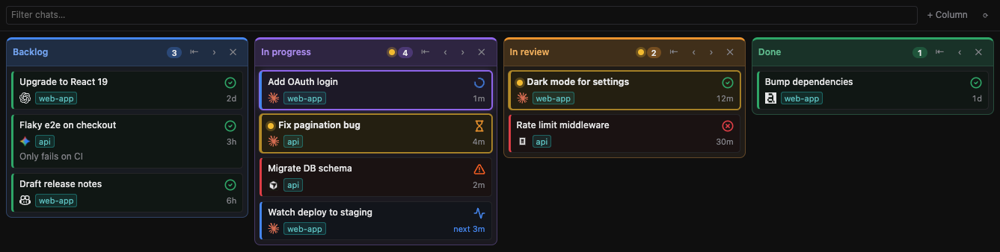
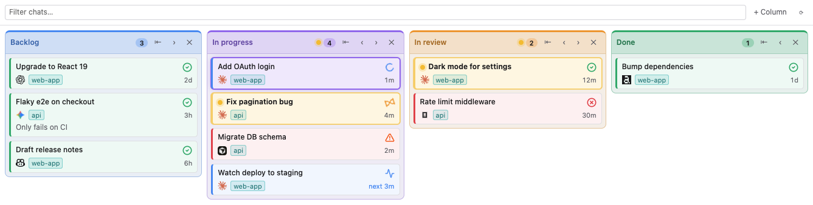

# Chat Board for Orca

**English** | [한국어](README.ko.md)

A kanban of your **agent chats**: the Claude, Codex, Cursor, Gemini and other agent tabs you have open, terminal or chat, across every Orca workspace. Orca's Workspace Board groups work by workspace. Chat Board groups it by conversation, which helps when you keep many chats on different topics open in the same workspace.



> **This is a fork** of [SantiagoCaprile/orca-chat-board](https://github.com/SantiagoCaprile/orca-chat-board), on the `workspace-sync` branch. It adds to release 1.1.1:
>
> - the board works on Windows (upstream issue #1);
> - it can follow Orca's Workspace Board in both directions;
> - a reply box on every card, to read a chat's last exchange and answer it, images included, without leaving the board;
> - checked chats, whose reply box opens by itself when they finish, and which can turn pink while they wait for your answer;
> - goal mode: plan a goal with the agent, keep it as a checklist the card follows, run it to its end, and have the work reviewed by a second, read-only Claude;
> - a button on the card that archives a chat by closing its tab in Orca;
> - a way to open an archived Claude chat again after Orca restarts;
> - a Korean UI.
>
> None of this is in an upstream release. The screenshots are the upstream ones and do not show it.

## Contents

- [Install](#install)
- [Using the board](#using-the-board)
- [Reply to a chat](#reply-to-a-chat)
- [Checked chats](#checked-chats)
- [Goal mode](#goal-mode)
- [The archive, and continuing a chat](#the-archive-and-continuing-a-chat)
- [Sync with the Workspace Board](#sync-with-the-workspace-board)
- [Settings](#settings)
- [When something looks wrong](#when-something-looks-wrong)
- [Permissions](#permissions)
- [Limitations](#limitations)
- [How it works](#how-it-works) and [Development](#development)

## Install

### The upstream release

```sh
orca plugin install SantiagoCaprile/orca-chat-board
```

Orca lists the access the plugin asks for (see [Permissions](#permissions)) and asks you to approve it. Then open **Chat Board** from the right sidebar's activity bar. On Windows this release shows an empty board; use the fork.

### This fork

The fork runs from a folder on your machine as an Orca *development plugin*. Orca loads the TypeScript files directly, so there is nothing to build, and it reloads the plugin whenever a file in the folder changes.

1. Get the code and switch to the branch:

   ```sh
   git clone https://github.com/walden4u/orca-chat-board
   cd orca-chat-board
   git checkout workspace-sync
   ```

2. Load the folder into Orca:

   ```sh
   orca plugin dev load .
   ```

   The plugin runs code, so the first load stops with `approval_required`. It lists the access the plugin asks for and prints the same command with `--approve <fingerprint>`. Run that command to approve it.

3. If you also installed the upstream plugin from the catalog, turn it off so you do not get two Chat Board panels:

   ```sh
   orca plugin disable santiagocaprile.chat-board
   ```

4. Check that it runs. The fork shows up as `local.chat-board` with the `dev` tag:

   ```sh
   orca plugin list
   # local.chat-board 1.1.1  running  trusted-worker, dev
   ```

5. Open **Chat Board** from the right sidebar's activity bar, or run `orca plugin open local.chat-board`.

The folder now stays under **Settings → Plugins → Development folders**, and Orca loads it again each time it starts. To remove it, run `orca plugin dev unload local.chat-board`.

Do not edit the files of a plugin installed from the catalog. Orca checks their hash and disables the plugin when they change. Make changes in the development folder.

## Using the board

Every tab that runs an agent is one card: terminal tabs, and Orca's chat tabs once they have a conversation. With the default settings the board has four columns of its own (Backlog, In progress, In review, Done), and new chats land in the first one.

| You want to | Do this |
|---|---|
| Read a chat's last reply and answer it | Click the card. See [Reply to a chat](#reply-to-a-chat). |
| Go to the chat in Orca | Double-click its card, or click ↗ on the card or in the reply box. |
| See what a chat was about | Hover its card for a moment. |
| Have a chat come to you when it finishes | Click the box at the top left of its card. See [Checked chats](#checked-chats). |
| Move a chat | Drag its card to another column, or up and down within a column. |
| Rename a chat or add a note | Click ✎ on the card. Enter saves, Shift+Enter starts a new line in the note. The name is the chat's Orca tab name. |
| Find a chat | Type in the filter box. It matches title, note, workspace and agent. |
| Update the board now | Click ⟳. |
| Hand a chat a goal and follow it to its end | Turn on goal mode in Settings. See [Goal mode](#goal-mode). |
| See at a glance which chats wait for your answer | Check them and turn on the pink setting. See [Pink: chats that wait for your answer](#pink-chats-that-wait-for-your-answer). |
| Put a chat away | Hover its card, click ▾, then click the red question. See [The archive](#the-archive-and-continuing-a-chat). |
| Continue a chat that was closed | Click **Archive N** in the toolbar. See [The archive](#the-archive-and-continuing-a-chat). |

### What a card shows

- **Status icon:** a spinner while the agent works, an hourglass when it waits for you, a check when it is done, a red cross when it was interrupted, an alert when it needs permission.
- **Yellow card with a dot:** the agent stopped while you were looking at another chat, like Orca's unread tab. Its column header gets a dot too. The mark clears when you read the chat in its reply box, open it, or when the agent starts working again.
- **Coloured ring:** the chat you have open in Orca now.
- **Pulse icon and "next 3m":** a loop or watcher is running there. That covers `/loop` (`ScheduleWakeup`), `CronCreate` schedules and `Monitor` watches. When a loop misses its run by about one interval, the card shows "no signal".
- **Box at the top left:** the check. Every open card has it at the same place: empty when the chat is not checked, filled with ✓ when it is. A click on it turns the check on or off. Archived cards have no box.
- **Pink card:** with the pink setting on, a checked chat whose agent has stopped and waits for you. See [Pink: chats that wait for your answer](#pink-chats-that-wait-for-your-answer).
- **Logo, workspace, time and note:** the agent's logo (the same icons Orca uses, for all 45 agents it knows), the workspace's name, the time since the last change, and your note.

Hovering a card also brings up its buttons at the top right: ↗ (go to the chat in Orca), ✎ (rename, note) and ▾ (archive). An archived card has ✎ and ✕ (remove from the board) there.

Hovering a card shows your last message and the agent's last reply in a popover, as wide as the panel and as tall as the room above or below the card.

### Columns

Add a column with **+ Column**, rename it by double-clicking its title, reorder it with ‹ ›, collapse it into a narrow strip with ⇤, and delete it. A deleted column's cards go to the first column. When you start talking to a chat in **Backlog**, its card moves to **In progress**; a setting turns this off.

With the [Workspace Board sync](#sync-with-the-workspace-board) on, the columns are Orca's workspace statuses instead, and most of this is done in Orca.

The UI follows Orca's theme (light or dark) and language (Spanish for `es-*`, Korean for `ko-*`, English otherwise).



## Reply to a chat

Click a card to open its reply box. It shows your last message and the agent's whole last reply, with the time of Orca's record, and a field to answer.

| You want to | Do this |
|---|---|
| Send an answer | Type it and press Enter. Shift+Enter starts a new line. |
| Use the prompt the agent suggests | Press Tab in the empty field. |
| Attach an image | Paste it into the field, or drop image files on the box. |
| Go to the chat itself | Click ↗ in the box. |
| Plan a goal, run it, have the work reviewed | The buttons next to Send, with goal mode on. See [Goal mode](#goal-mode). |
| Close the box | ✕, Escape, or a click outside it. What you typed is kept for that chat until the panel reloads. |

- **Send** types your text into that chat's terminal as your next prompt. The box closes and a line under the toolbar confirms it.
- **Tab takes the agent's suggestion.** When the agent has a next prompt waiting in its own input (Claude Code shows one dimmed after a reply), the reply box shows it dimmed in the empty field, and Tab fills it in for you to send or change. It is read from the chat's terminal when the box opens. Text you typed in that terminal and did not send shows up the same way.
- **Images:** up to 5 per message, 10 MB each, PNG, JPEG, GIF or WebP. They show as thumbnails you can remove, and Send attaches them before your text; an image alone can be sent too. The worker writes each one to `orca-chat-board` in your temp folder and pastes its path into the chat's terminal, where Claude Code turns the path of an image file into an attached image (`[Image #1]`). Other agents may see only the path. Files older than three days are removed the next time an image is sent.
- **The chat beside the box.** With the setting **Show the chat in Orca with its reply box** on, Orca also switches to that chat's tab when its box opens, so the whole conversation is next to the box. A box that opened by itself switches only once you click in it: switching earlier would take away the tab you are typing in.
- **Orca's chat tabs** can be read in the box but not answered, because Orca has no command to send to them. A chat that asks for permission opens read-only too: answer it in the chat (↗).
- **When Orca's record is old.** Some sessions stop reporting to Orca, for example ones that were open when Orca restarted. If Orca's record of a chat is more than two minutes behind that chat's terminal, the box shows the terminal's screen as it is now under the old exchange. After you send from the box, what you sent is shown there until Orca's record catches up.

## Checked chats

Check a card (the box at its top left, always there; click again to uncheck) and its reply box opens by itself when that chat's agent finishes or asks you something, also when its tab is the one on screen in Orca.

- **One after the other.** Answer the box, or leave it unanswered with **Next** or ✕, and the box of the next checked chat that finished opens, in the order they finished. The box says how many are waiting.
- **It does not take the keyboard.** A box that opened by itself leaves the cursor where it is, so what you are typing elsewhere stays there. Click its field to type in it.
- **It waits its turn.** Nothing opens while a box, an edit or a drag is in progress, or while the panel is out of sight; it opens when you are back.
- **Leaving for the chat itself (↗) holds the rest back** for two minutes, or until another checked chat finishes.
- **Loops do not open a box for each run.**

The check is saved with the card. Chats that are not checked only turn yellow.

### Pink: chats that wait for your answer

A reply box that opened by itself is easy to miss once it is closed, and a finished chat looks like any other card. The setting **Pink for checked chats that wait for an answer** (shown in Korean in this fork: "답을 기다리는 체크 대화를 핑크로 표시", off by default) marks the chats where the next word is yours.

**When a card is pink.** All three must hold:

1. the setting is on;
2. the card is checked;
3. its agent is not working: it finished (check icon), it asked you something (hourglass), or it needs permission (alert).

Whether you have already looked at the chat does not matter. A chat you read an hour ago and did not answer is still pink.

**When the pink goes away.**

- You answer, and the agent starts working again. The card is pink again when that turn ends.
- You uncheck the card. Do this for a chat you do not mean to answer.
- The chat is archived, or the setting is turned off.

**What turns pink.**

- The card: its background and border.
- The toolbar: a pink tint and a pink line under it while at least one card is pink. This shows that something waits even when that card is scrolled out of view or its column is collapsed.

**Pink and yellow.** Yellow is the "not seen yet" mark and works for every chat, checked or not; it clears as soon as you look. Pink is about the answer, only for checked chats, and stays until you answer. On a checked chat that is both, pink is drawn.

**It is not the reply queue.** Which reply box opens next still depends on what you have not seen yet (see above). Pink only colours the board; it opens nothing.

A chat with no status icon (Orca has not reported a status for it, see [Limitations](#limitations)) is never pink.

## Goal mode

**Off by default.** Turn on **Goal mode** under Settings → Plugins → Chat Board (the settings screen of this fork is in Korean: "목표 모드"). While it is off, none of what follows shows on the board and none of it runs.

Goal mode is for work you hand over and come back to. The goal lives in one place that the agent, you and a reviewer all read: **`GOAL.md` in the chat's folder**, a checklist the agent writes and ticks off. Three buttons in the chat's box, the one a click on the card opens, drive it:

| Button | What it does |
|---|---|
| **Plan goal** | Sends the goal you typed in the field to the agent, to plan in plan mode. The agent looks around without changing anything and writes a plan: steps, each with a way to check it. Once you approve the plan, it writes the steps to `GOAL.md` and works through them, ticking an item when its check passes. |
| **Run goal** | For when the agent stopped before the end. Sets the checklist as the chat's goal with Claude Code's own `/goal`, which keeps the agent at it until every item is ticked. |
| **Review** | Has a second Claude, the judge, check the items in the files instead of taking the agent's word. |

Plan goal and Run goal are there for Claude Code chats in a terminal; Review for every chat whose folder is on this machine.

### A goal from start to finish

1. Click the card, type the goal in the field ("a simple to-do app with Phoenix") and press **Plan goal**.
2. Read the plan **in the chat itself** (↗): Claude Code asks there whether to go ahead. Approve it, or say what to change. The box cannot answer that question.
3. The agent writes `GOAL.md` and starts on the first item. The card shows **Goal 2/6** as items get ticked, and the box lists the items.
4. If the agent stops with items left, press **Run goal**.
5. When every item is ticked, press **Review**.

The button whose turn it is stands out, and each button says, while the pointer is on it, what it is for and when to press it.

About the two commands behind the buttons:

- **Plan mode** is Claude Code's: while planning, the agent cannot change files, and nothing starts until you approve.
- **`/goal`** is Claude Code's too: at the end of each turn it checks, from what the conversation shows, whether the condition holds, and keeps the agent going until it does. The command the button sends asks for the output of every item's check to be shown, tells the agent to stop and ask when it is stuck, and ends after 30 turns.

You can write or edit `GOAL.md` yourself: any Markdown checklist (`- [ ] …`) counts. Several chats in one folder share that folder's file.

### Review: a second opinion that reads the files

`/goal` judges by what the agent says in the conversation. **Review** has a second Claude, the judge, read the folder. It did not see how the work was done, it can only read (no commands, no changes, nothing outside the folder), and nothing is sent to the chat.

The judge is given:

- `GOAL.md` as it stands. Each item is a criterion. A ticked box is the agent saying the item is done, not evidence that it is.
- Your last prompt in that chat and the agent's last message, as context and as claims to check. The goal decides: work that answers the last prompt and leaves an item of the goal undone does not pass.
- What changed, from git: everything since the commit that added `GOAL.md`. When the file is not committed, what is not committed yet; and when nothing is uncommitted, the last commit. A long diff is cut and the judge reads the files for the rest.

In a folder without `GOAL.md` the work is checked against your last prompt only, and the result says so.

The result is a **scorecard** in the box: the verdict, each criterion with ✓ or ✗ and what the judge saw, what must be fixed with file and line, the time and the cost.

| Verdict | Meaning | A reply is drafted |
|---|---|---|
| Everything asked for is met | Every criterion passed. | no |
| N things to fix | A criterion is not met, something that worked is broken, or the agent claimed something the files do not show. | yes |
| The judge could not tell | The criteria are ambiguous, or the answer lies outside the folder. | no |

When something must be fixed, the **reply drafted from it is put in the field**, selected: Enter sends it as it is, typing replaces it. It ends by telling the agent to check each point itself and, for one that is wrong, to change nothing and say why. Nothing is sent unless you send it. Once the chat has moved on, a review is of an earlier turn: the box then shows one line that it is kept (click it to read it) and no longer offers its draft.

**A judge can be wrong.** How this one was checked, and where it failed, is written up in [`docs/auto-reply-research.md`](docs/auto-reply-research.md) (in Korean). That is why its reply is a draft. The board counts what you do with the drafts of each chat (sent as they were, edited, not used) and shows the count under the scorecard. A draft counts as not used when the chat goes on to another turn without it; asking for another review does not count.

**The check command.** The judge can read files but cannot run anything. So the agent ends `GOAL.md` with a line `verify: <command>` (usually the test suite), and a review runs that command in the chat's folder first (up to 5 minutes) and gives the judge its exit code and the end of its output. The box shows the command under the goal's list, and the scorecard shows how it ended. The judge is told that the agent chose the command. It runs with your account, as the agent's own commands do; to change or remove it, edit that line of `GOAL.md`. A `GOAL.md` without the line gets a review without a check.

### What it costs

Planning and running a goal are ordinary turns of the chat's own agent. A review is a separate run of Claude Code under your login, on the same usage as your chats: with Sonnet about 12 seconds and 3 cents for a small change, 30 seconds and 20 cents for a large one in this repository. One review runs at a time, each capped at 5 minutes and half a dollar, and only when you press the button.

## The archive, and continuing a chat

A chat you close goes to the archive and keeps its column, note and check. A card is on the board only while its tab is open in Orca, so there are two ways to archive one, and both close the tab:

- **In Orca:** close the chat's tab. The card moves to the archive at the next check (within 15 seconds, or at once with ⟳).
- **From the card:** hover the card and click **▾** among the buttons at its top right. The button turns red and asks; click it again within 3 seconds to go on, or leave it and nothing happens. Orca then closes that chat's whole tab and the card moves to the archive at once. If that chat's reply box was open, it closes too.

The red question depends on the chat:

| The chat | The question | What you lose |
|---|---|---|
| A Claude chat in a terminal tab, not working | "Close the tab?" | Nothing: it can be continued from the archive. |
| Any chat whose agent is working | "Stop the agent and close?" | The turn that is running. |
| Another agent's chat | "Close? Cannot be opened again" | The way back from the board: only Claude chats have ↻ Continue. |

Orca's own chat tabs (not terminals) cannot be closed from outside; the button says so and leaves the chat alone.

The archive itself is put away by default: **Archive N** in the toolbar shows how many chats it holds and opens it under the board, up to 40% of the panel's height. The same button, or the archive's title line, puts it away again. Remove one card with ✕, or all of them with **Clear**.

Orca does not keep agent tabs across a restart, so after one most cards are in the archive. To continue such a chat, click **↻ Continue** on its card:

1. Claude starts in that card's workspace the way Orca's own new-agent tab does, so Orca tracks its status, and Orca shows the tab.
2. A few seconds later Claude's list of that folder's conversations appears (the plugin types `/resume`). Pick the one to continue. Nothing is chosen for you.
3. The card leaves the archive and goes back to its column under the new tab, with its note and check.

This works for Claude chats in terminal tabs. Other agents and Orca's chat tabs have no such button yet.

## Sync with the Workspace Board

Click **⇄** in the panel's toolbar, or turn on **Sync with the Workspace Board** in Settings. From then on the two boards show the same thing from two sides: Orca's board by workspace, this one by chat.

- **Columns are workspace statuses.** You get Orca's statuses (Todo, In progress, In review, Done and your custom ones). Turning sync on replaces the columns you had; each chat goes to the column of its workspace's status.
- **Drag a chat here, and Orca follows.** Dropping a card in another column sets that workspace's status in Orca. The other chats of the same workspace move along, because a workspace has only one status.
- **Move a workspace in Orca, and the chats follow here.** Orca does not announce the change, so the panel shows it within about 10 seconds. Click ⟳ to see it at once.
- **Orca's side wins.** At every refresh the cards are put back in the column of their workspace's status.
- **Column names are Orca's status names.** Rename a status in Orca and the column follows at the next refresh. In Orca, open the Workspace Board, then its **Board settings** menu; the **Statuses** list there renames, adds and removes statuses. While the names come from Orca, a column cannot be renamed here.
- **Columns can be reordered (‹ ›) and collapsed (⇤) here, but not added or deleted.** A status you add in Orca gets a column at once, and one you remove loses its column once no workspace uses it.
- **"Move to In progress when you start a chat" is off while synced**, since the status now belongs to the workspace.

Click ⇄ again to stop. The columns stay as they are and become ordinary columns that you can rename, add to and delete.

### How the status names are read

Neither Orca's CLI nor its plugin API tells a plugin what a status is called. So, only while the sync is on, the worker opens Orca's own profile database read-only and takes the status list from it: `profile-state.db` in the active profile's folder under Orca's data folder (`%APPDATA%\orca` on Windows), document `ui`, field `workspaceStatuses`. It reads the id and the label of each status and nothing else, and never writes to that file.

This is not an Orca interface, so an Orca update can change it. When the read fails for any reason, the worker logs `status names not read from Orca's profile` once. The columns then keep the names they had, a new custom status shows up under its id (`status-5`), and you can rename columns here again by double-clicking the title. It has been tried on Windows with Orca 1.4.255 only.

## Settings

Under **Settings → Plugins → Chat Board**:

| Setting | Default | What it does |
|---|---|---|
| Move to In progress when you start a chat | on | Talking to a chat in Backlog moves its card to In progress. Does nothing while the sync is on. |
| Sync with the Workspace Board | off | Columns become Orca's workspace statuses. See [Sync](#sync-with-the-workspace-board). |
| Check Orca automatically | on | The panel asks Orca what changed while it is on screen. See below. |
| Show the chat in Orca with its reply box | off | Orca switches to a chat's tab when its reply box opens. See [Reply to a chat](#reply-to-a-chat). |
| Pink for checked chats that wait for an answer | off | Checked chats whose agent has stopped are drawn pink. See [Pink](#pink-chats-that-wait-for-your-answer). |
| Goal mode | off | Shows Plan goal, Run goal and Review in the chat's box, and a card's goal progress. Off: none of it shows or runs. See [Goal mode](#goal-mode). |
| Show agent logo | on | The agent's logo, or its name, on each card. |
| Show workspace | on | The workspace's name on each card. |
| Show agent status icon | on | Working, waiting, done, interrupted, needs permission. |
| Show time since last change | on | Time since the agent's status changed or the chat last printed something. |
| Show notes | on | Your note under the card's title. |
| Show a preview on hover | on | The popover with the last exchange. |
| Language (Auto, English, Español, 한국어) | Auto | Auto follows Orca's language. |

The settings screen of this fork is in Korean, whatever the panel's language: Orca takes a setting's title and description from the plugin's manifest, which holds one language. The names above are the English ones in the same order.

### Check Orca automatically

Orca does not tell plugins when you switch tabs, so while the panel is on screen it asks Orca:

- every 3 seconds while an agent is working, or within 30 seconds of you using the panel (moving the pointer over it, sending a reply);
- every 15 seconds while nothing moves.

Each check starts the `orca` CLI, a second or more of work on Windows, and only one runs at a time. Turn the setting off to stop them and update by hand:

| | On | Off |
|---|---|---|
| Agent status icons | live | live |
| A chat opens or closes | at once | at once |
| Ring around the open chat | within 3 seconds (15 while idle) | when you click a card here, or on ⟳ |
| Yellow "not seen yet" mark clears | within 3 seconds (15 while idle) | when you click the card here, or on ⟳ |
| Changes made on Orca's Workspace Board (with the sync on) | within about 10 seconds (15 while idle) | on ⟳ |
| Status of a chat Orca lost track of (see [Limitations](#limitations)) | a few seconds behind | on ⟳ |

Opening the panel always reads the board afresh, and ⟳ works either way.

## When something looks wrong

| What you see | What to do |
|---|---|
| The board is empty or shows an error | Run `orca plugin logs local.chat-board`. A failed CLI call is logged with the reason the CLI gave. |
| The plugin is listed but not `running` or `idle` | It is waiting for approval. Run `orca plugin dev reload .` and follow the `--approve` command it prints. |
| After restarting Orca, most cards are gone | They are in the archive. Click **Archive N**, then **↻ Continue** on a card. |
| A checked chat finished and no reply box opened | Look in `orca plugin logs local.chat-board` for lines starting with `checked chat` and `panel: reply`. They say what the worker saw and what the panel did with it. |
| The reply box shows an old exchange | Orca's record of that chat is behind. The time next to "Agent" is the record's. If the chat is more than two minutes ahead, the terminal's screen is shown under it; closing the chat and continuing it from the archive makes Orca track it again. |
| "Not sent: … timed out" in the reply box | The message may still arrive. Look at the chat (↗) before sending it again. |
| A column is called `status-5` | The status names could not be read from Orca. Look for `status names not read` in the log; meanwhile, double-click the title to rename the column. |
| Double-clicking a column title does nothing | The sync is on and the name is Orca's. Rename the status in Orca. |
| A card did not move after you changed a status in Orca | Wait 10 seconds or click ⟳. |
| A checked chat is not pink | Check the three conditions in [Pink](#pink-chats-that-wait-for-your-answer): the setting is on (it is off by default), the box on the card is checked, and the agent is not working. A card with no status icon is never pink. After changing the setting, click ⟳ if the board does not follow. |
| A card you archived with ▾ is back on the board | Its tab is still open in Orca, so the close did not go through. Look for `archive failed` in `orca plugin logs local.chat-board`. |
| There are no goal buttons in the chat's box | Goal mode is off, as it is by default. Turn on **Goal mode** in Settings. Plan goal and Run goal show for Claude Code chats in a terminal only. |
| The agent made a plan and nothing happens | It waits for you to approve the plan. Go to the chat (↗) and answer there; the box cannot. |
| The card shows no goal progress | Its folder has no `GOAL.md` with a checklist (`- [ ] …`) yet, or goal mode is off. The card follows the file at each check of the board, so it is a few seconds behind. |
| Run goal says there is no GOAL.md | Plan the goal first, or write the checklist yourself. |
| Review says the folder is not on this machine | The chat's workspace is on a remote host (SSH, WSL). A review runs Claude Code here, in the chat's folder, so it cannot review those. |
| A review failed | The scorecard says why. "claude was not found": Claude Code must be installed where the worker finds it on PATH. `error_max_budget_usd`: the review hit its spending cap, the change is too large to review whole. "Nothing to review against": the folder has no `GOAL.md` and the chat has no request yet. The log (`orca plugin logs local.chat-board`) has a line starting with `judge` for every review. |
| A review was cut off | The plugin was reloaded while the judge ran, for example because a file in its development folder changed. Run it again. |
| A finding in a review is wrong | Leave it out of the reply. Or send the draft as it is: it tells the agent to change nothing for a finding that is wrong and to say why. |
| A card has no status icon | Orca has not reported a status for that session yet. See [Limitations](#limitations). |

## Permissions

Orca asks you to approve these when you load the plugin. Here is what each one is used for:

| Permission | What the plugin does with it |
|---|---|
| **Runs its own code** (Node worker) | Runs the Orca CLI commands listed below, because the plugin API alone sees only the focused workspace and cannot open, rename or write to tabs. For a review it also runs git and Claude Code. Also the file accesses listed below. |
| `storage:own` | Saves the board: columns, card positions, notes, checks, the last review of each chat and the count of its drafts, agent status and monitors. All of it stays in the plugin's own folder. |
| `agent:read` | Agent status icons, the yellow "not seen yet" mark, and moving a Backlog card when you start a chat. |
| `workspace:read` | Knows which tab you are looking at, for the "not seen yet" mark and the open-chat highlight, and refreshes the board when chats open or close. |
| `settings:own` | The plugin's options in Orca's Settings. |
| Hook `agent.tool.after` (observe only) | Detects loops and watchers. Orca hands this hook every tool call an agent makes. The plugin looks only at `ScheduleWakeup`, `CronCreate`/`CronDelete`, `Monitor` and `TaskStop`, keeping their timing and description, and drops every other call without storing it. The hook never blocks or changes a call. |

### The commands the worker runs

| Command | When | For |
|---|---|---|
| `orca terminal list`, `orca worktree ps` | at every refresh | The chats in every workspace, their status, chat tabs included. |
| `orca terminal switch`, `orca worktree activate` | you open a chat | Showing its tab, or its workspace for a chat tab. |
| `orca terminal rename`, `orca chat rename` | you rename a card | The chat's tab name. |
| `orca terminal send` | you press Send, Plan goal or Run goal in a chat's box | Your text and the paths of the images you attached; the request to plan your goal; or the `/goal` command. To that one chat. |
| `orca terminal read --screen` | a reply box opens | The agent's suggested next prompt, and the screen itself when Orca's record of the chat is behind its terminal. |
| `orca terminal read --screen` | a terminal has fresh output long after Orca's record of a finished turn | Telling whether that chat is working. Only a busy-or-not answer is kept. |
| `orca terminal close --tab` | you click ▾ on a card, then confirm | Closing that chat's tab, which stops the agent in it. |
| `orca agent launch`, then `orca terminal send` with `/resume` | you click ↻ Continue on an archived card | Starting Claude in that workspace with its list of conversations. |
| `orca worktree list`, `orca worktree set --workspace-status` | the Workspace Board sync is on | Reading every workspace's status, and setting one when you drag a card. |
| the `verify:` line of `GOAL.md`, through `cmd.exe /d /s /c` (`/bin/sh -c` elsewhere) | a review starts, when `GOAL.md` has that line | The command the agent wrote there with the plan, in the chat's folder, with your account. Nothing runs without the line. |
| `git rev-parse`, `git log`, `git status`, `git diff`, `git show`, `git cat-file` | a review starts | Which commit added `GOAL.md`, and what changed in the chat's folder since. Git only reads: it runs with `--no-optional-locks`, so it does not even refresh the index. |
| `claude -p --restricted --tools Read,Grep,Glob …` | you click Review | The judge: Claude Code without a screen, in the chat's folder, with the three reading tools only, your settings files and hooks left out, and its session not saved. |

### Files outside the plugin's own folder

- **Read:** Orca's profile database, read-only, for the ids and names of the workspace statuses, and only while the sync is on. See [how the status names are read](#how-the-status-names-are-read).
- **Read:** `GOAL.md` in the folder of each open chat, with goal mode on, for the card's progress.
- **Read:** the folder of a chat you review. Git reads it for what changed, and the judge reads and searches it. Nothing in it is changed.
- **Written:** the images you attach in a reply box, as files in `orca-chat-board` under your temp folder, which the agent needs to read them.

### What stays where

The plugin itself makes no network requests. A review is the one thing that sends something out, and it does so through Claude Code: the judge's task (the folder's `GOAL.md`, your last prompt in that chat, the agent's last message, the diff) and the files the judge reads go to Anthropic, the same service and the same login your Claude chats in that folder already use. It happens only when you click Review. The verdict is kept on the card.

Some of what Orca's CLI returns, such as a preview of each terminal's latest output and the agent's last message, prompt or tool input, is never stored by the plugin; it keeps only titles, agent type and status. The hover preview and the reply box read your last prompt and the agent's last reply from Orca when you ask, show them, and keep them for a few seconds in memory only. A terminal screen read for the reply box is shown and not stored. The plugin sends input to an agent only when you press Send, Plan goal, Run goal or ↻ Continue: the text you typed, the images you attached, the request or command those buttons make of it, or `/resume`. It closes a tab only when you click ▾ on that chat's card and confirm.

## Limitations

- Orca puts plugin panels in the right sidebar only, and a plugin cannot draw outside its panel. The reply box is as wide as the sidebar.
- Orca does not tell plugins about tab switches, so the panel asks. See [Check Orca automatically](#check-orca-automatically).
- The reply box shows the last exchange only. Orca does not hand a chat's history to plugins.
- Orca's chat tabs show up once they have a conversation. Opening one shows its workspace but not the tab itself, because Orca cannot switch to a chat tab from outside yet, and nothing can be sent to one. Loop monitoring is not detected in chat tabs, since Orca's tool hook names no terminal for them.
- Monitoring is recognised from tool calls, because Orca does not expose its own monitoring state to plugins. Only Claude Code's tool names are known so far. Orca does not run this hook for agents on SSH or WSL hosts.
- **Chats Orca lost track of.** A chat shows no status icon until Orca reports one for it. Some sessions, such as ones started before Orca's status hooks were set up or ones that were open when Orca restarted, never report. For those the plugin reads the state off the terminal instead: when a terminal has fresh output long after Orca's record of a finished turn, it reads that terminal's screen once, and a Claude Code spinner line or an "esc to interrupt" hint there means a turn is running; the turn is over when the terminal goes quiet and the screen no longer shows it. This runs with the automatic check or on ⟳, lags a few seconds behind, misses turns shorter than that, and knows only "working" and "done". Other agents' screens are not recognised yet.
- Attached images, the suggested prompt and ↻ Continue rest on how Claude Code behaves in a terminal. Other agents get the image's path as text and have no suggestion or Continue button.
- **Goal mode.** Plan goal and Run goal rest on Claude Code's plan mode and `/goal`, so they are there for Claude Code chats in a terminal only, and the plan is approved in the chat, not in the box. A card's progress is what the boxes in `GOAL.md` say: an agent can tick an item it did not finish, which is what Review is for. The judge is Claude Code too, so it must be installed and logged in on this machine, also to review another agent's work. It reads; it cannot run the tests or the program. It works on folders on this machine only. When several chats work in one folder it cannot tell whose change is whose, and says so. It sees the goal file, the last exchange and the changes, not the conversation. One review runs at a time.
- Upstream is tested on macOS. This fork is used on Windows 10 with Orca 1.4.255. On Linux the worker uses the CLI launcher Orca ships (`orca-ide`), but this has not been tried yet. If the board stays empty there, please open an issue.

## How it works

- `src/worker.ts` is a Node worker. It lists chats through the Orca CLI, tracks agent status and tool calls from Orca's events and hooks, and answers the panel.
- `src/board.ts` holds the pure board logic: merging chats, moving cards, columns and the unseen mark. A chat that comes back with a new tab id, for example after an Orca restart, is matched back to its card by pty id, or by title and workspace.
- `src/cli.ts` is the one place that starts the `orca` CLI.
- `src/sync.ts` holds the rules of the Workspace Board sync, and `src/profile.ts` reads the status names from Orca's profile.
- `src/monitor.ts` recognises loops and watchers from tool calls and decides when one has lost its signal.
- `src/screen.ts` reads a busy turn and the suggested prompt off a terminal's screen, and `src/attach.ts` keeps and saves the images of a reply.
- `src/goal.ts` reads the checklist of a `GOAL.md`. `src/judge.ts` holds what the judge is asked, how its answer is read and the reply drafted from it. `src/tools.ts` starts Claude Code and git and reads the goal file. Why the judge is set up the way it is, and how it was checked, is in [`docs/auto-reply-research.md`](docs/auto-reply-research.md).
- `panel/` is the HTML panel. It uses native drag & drop, and holds the board (`index.ts`), the reply box (`reply.ts`), the hover preview (`preview.ts`), the strings (`i18n.ts`), status icons (`icons.ts`) and agent logos (`logos.ts`).

## Development

```sh
orca plugin dev watch . --check   # load this folder into Orca and reload on save
orca plugin test .                # tests
npx -y -p typescript tsc -p tsconfig.ci.json --noEmit   # type-check
orca plugin shot local.chat-board --panel board --width 900 --out board.png
orca plugin logs local.chat-board # the worker's log
```

Type-check with `tsconfig.ci.json`. `tsc -p .` writes `.js` files next to the sources.

CI (GitHub Actions, Linux, macOS and Windows) type-checks against a snapshot of Orca's typings and runs the tests that need no Orca host. See [`ci/`](ci/README.md).

## Credits

The agent logos are the ones Orca ships for each agent. They belong to their respective owners.

## License

[MIT](LICENSE)
